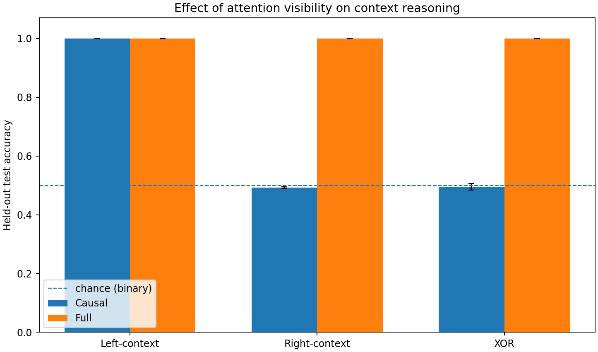
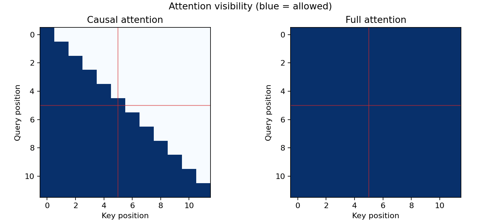
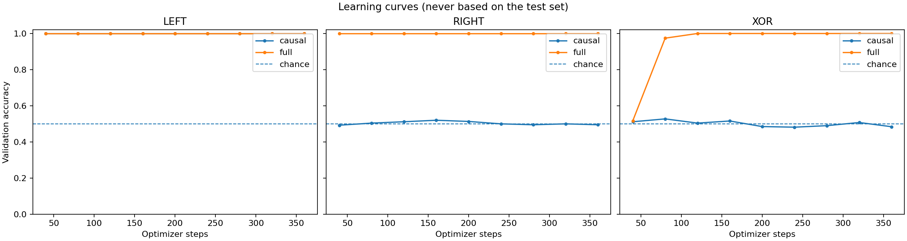
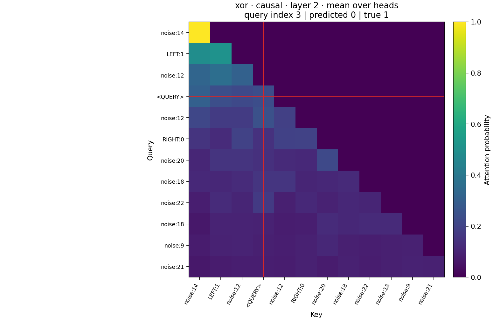
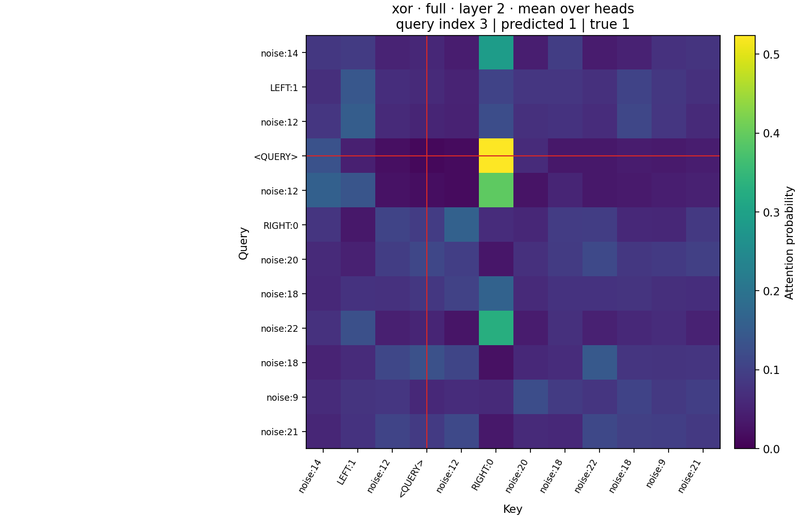

# Causal vs. Full Attention — A Controlled Transformer Study

**From-scratch Transformer architecture · PyTorch · Reproducible experiments · 18 trained runs · 12 automated tests**

[](https://github.com/volodymyrhalian/causal-vs-full-attention/actions/workflows/ci.yml)


> **Research question:** If two identical Transformers differ **only in their attention mask**, which context-dependent classification problems can each solve at a designated query position?

This project is an **independent, runnable portfolio implementation** related to my academic interest in causal vs. bidirectional Transformer attention. It is not a claim that the research was previously submitted as a university deliverable. All reported numbers below were measured in the included synthetic experiment; they are not benchmark results on natural language.



## Key findings

On three deterministic synthetic tasks, one may need to read only the past (`left`), only the future (`right`), or both (`xor`). Both models classify using the hidden state **at the same query position**, so causal masking genuinely restricts the available information.

| Target depends on | Causal attention | Full attention | Theoretical causal limit |
|:--|--:|--:|--:|
| Previous context (`left`) | **100.00% ± 0.00** | **100.00% ± 0.00** | 100% |
| Future context (`right`) | **49.25% ± 0.31** | **100.00% ± 0.00** | 50% |
| Both (`xor`) | **49.55% ± 1.10** | **100.00% ± 0.00** | 50% |

*Mean ± sample standard deviation of held-out accuracy over seeds 7, 11 and 19. Every run uses 2,000 distinct synthetic test sequences. This is a deliberately constructed **information-access test**, not evidence of general superiority of full-attention language models.*

### Why it matters

A causal Transformer cannot use tokens that appear **after its query position**. Therefore it cannot predict an independently sampled future clue at that position more accurately than chance. A full-attention model can retrieve that clue, and it can combine the left and right clues to solve XOR. This experiment isolates context availability from differences in architecture, training budget, and parameter count.

## Architecture

| Parameter | Value |
|--|--|
| Blocks | 2 pre-LN Transformer blocks |
| Attention | Scaled dot-product, 4 heads |
| Embedding width | 48 |
| Feed-forward width | 96, GELU |
| Trainable parameters | **40,034** per variant |
| Positions | Learned, max 16 |
| Classifier | Query-position hidden state → 2 logits |
| Main ablation | **`is_causal=True` vs `is_causal=False`** |

The attention path uses PyTorch `torch.nn.functional.scaled_dot_product_attention` for efficient inference and training, plus a separate diagnostic-only path for attention visualization. There is **no pretrained LM**, no token leakage via global pooling, and no network dependency during experiments.



## Experimental design

The generated sequence includes two randomly positioned cue tokens around a query marker, plus noise tokens. Each cue holds an independent random bit:

```
... LEFT:1 ... <QUERY> ... RIGHT:0 ...
                  ^
            classification here
```

The task label is `LEFT`, `RIGHT`, or `LEFT XOR RIGHT`. Both models receive exactly the same input tokens; the readout uses exactly the same position. The target is not stored in the input.

All experiments use 6,000 train, 1,200 validation and 2,000 test examples, **360 optimizer steps**, identical initialization per paired mode, best validation checkpoint selection, and three training seeds. See [Methodology](docs/METHODOLOGY.md) for controls, caveats, and statistics.

## Reproduce locally

Requires Python 3.10+ and enough space for PyTorch. On Windows PowerShell:

```powershell
py -m venv .venv
.venv\Scripts\Activate.ps1
python -m pip install -e ".[dev]"
python -m pytest -q
```

Run one quick experiment:

```bash
python -m attention_lab.experiment --tasks right --seeds 7 --steps 180 --output results/custom_quick
```

Re-run the complete 18-run benchmark:

```bash
python -m attention_lab.experiment \
  --tasks left right xor --modes causal full \
  --seeds 7 11 19 --steps 360 --eval-every 40 \
  --train-size 6000 --val-size 1200 --test-size 2000 \
  --save-checkpoints --output results/full_benchmark
```

> On Windows PowerShell, place the benchmark command on **one line**, or replace the Bash `\` continuation with PowerShell backticks.

All runs automatically save metrics, test predictions, model metadata, paired 95% bootstrap confidence intervals, learning curves, and attention-mask visualizations. Runs are deterministic in the tested CPU environment; hardware/backend changes can introduce minor numeric variation.

## Explore the interactive notebook

[**Attention Explorer (Jupyter Notebook)**](notebooks/attention_explorer.ipynb) runs against the included real checkpoints. It visualizes causal/full masks, compares empirical results, tests future-token invariance and plots query-token attention. The notebook contains executed outputs so it is readable directly on GitHub without running anything.

```bash
python -m pip install jupyter
jupyter notebook notebooks/attention_explorer.ipynb
```

## Try a trained model

Six small seed-7 checkpoints are included in [`models/`](models). To inspect an example with full attention:

```bash
python -m attention_lab.demo --task xor --mode full
```

Compare the same clue with the causal model:

```bash
python -m attention_lab.demo --task xor --mode causal
```

The demo displays the input sequence, predicted probabilities and how much the logits change after future tokens are replaced. **The causal logits must remain invariant.**



### Diagnosing attention

The images below are **descriptive attention weights**, averaged over heads at the final Transformer layer. Attention maps should not be interpreted as faithful causal explanations of model decisions.

| Causal | Full |
|:--:|:--:|
|  |  |

## Reliability and research hygiene

- **Controlled ablation:** same model size, parameter initialization, train/test examples, readout and optimizer; only attention visibility changes.
- **Leakage checks:** tests verify that future-token mutation leaves causal logits unchanged, and that future keys receive zero causal attention probability.
- **Transparent outcomes:** [`runs.json`](results/benchmark_3seeds/runs.json) stores per-example predictions; [`summary.csv`](results/benchmark_3seeds/summary.csv) includes per-run results; [`paired_bootstrap.json`](results/benchmark_3seeds/paired_bootstrap.json) provides paired test-set intervals.
- **Auditable metrics:** `python scripts/verify_results.py` recomputes accuracy from predictions.
- **CI:** tests run automatically on commits via GitHub Actions.
- **Limits stated clearly:** [Methodology](docs/METHODOLOGY.md) and [Model Card](docs/MODEL_CARD.md) describe where these results apply and where they do not.

## Repository map

```text
src/attention_lab/
    data.py          # deterministic generated inputs and task targets
    model.py         # attention, Transformer blocks, controlled classifier
    train.py         # model selection and held-out evaluation
    metrics.py       # accuracy, balanced accuracy, paired bootstrap CI
    experiment.py    # end-to-end command-line experiment runner
    plots.py         # masks, attention heatmaps, learning and comparison plots
    demo.py          # run seed-7 pretrained checkpoints locally
models/              # six real trained CPU model checkpoints (seed 7)
notebooks/           # executed, exploratory Jupyter notebook
results/benchmark_3seeds/
    runs.json        # 18 actual runs with per-example predictions
    summary.csv      # test/validation accuracy per run
    aggregate.json   # mean, sample SD, protocol details
    paired_bootstrap.json
assets/              # generated result figures
scripts/             # verification utility
tests/               # unit and end-to-end smoke tests
.github/workflows/   # CI
```

## Next steps

A natural next extension is to compare attention masks on a **real, position-level tagging dataset** with matched encoder/decoder training objectives, investigate longer context lengths, and add several held-out data-generation regimes. Those extensions are **not claimed as completed work here**.

---

**Created by Volodymyr Halian** · [Portfolio & CV](https://volodymyrhalian.pages.dev/) · [GitHub](https://github.com/volodymyrhalian) · [LinkedIn](https://www.linkedin.com/in/volodymyr-halian-76a2a23b4/)

**References:** [Attention Is All You Need](https://arxiv.org/abs/1706.03762) · [BERT](https://arxiv.org/abs/1810.04805) · [PyTorch SDPA documentation](https://docs.pytorch.org/docs/stable/generated/torch.nn.functional.scaled_dot_product_attention.html)
